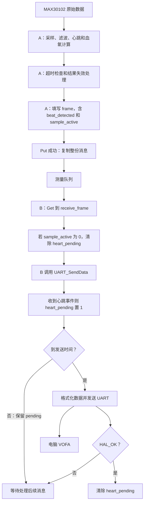

# MAX30102 模块迁移记录

更新日期：2026-10-11。

这份文档持续记录本次模块化学习。后续每完成一个迁移项，更新总表并追加该项的目的、迁移范围、变量归属、调用变化、遇到的问题和验证结果。代码尚未检查通过时，不标记为完成。

## 1. 为什么迁移

原来，传感器读写、初始化、滤波、心跳检测、血氧统计、串口发送都集中在 `main.c`。迁移的目标是按职责组织代码，让主循环负责安排调用，让模块负责具体实现，便于之后接入手表工程。

迁移通常保留算法和参数，但要重新确认函数接口、变量归属和错误处理。把函数复制到另一个文件，并不等于完成迁移。

最初的拆文件阶段不涉及 FreeRTOS；目前已在 F103 工程中将测量流程移入任务 A，进度见第 4 节后续记录。拆文件本身不保证全局状态可以被多个任务同时访问。

## 2. 当前进度

| 迁移项 | 目标文件 | 当前状态 |
|---|---|---|
| `MAX30102_ReadBytes()` | `Core/Src/max30102.c` | 代码及编译检查通过 |
| `MAX30102_WriteReg()` | 同上 | 代码及编译检查通过 |
| `MAX30102_Init()` | 同上 | 代码及编译检查通过 |
| `MAX30102_ReadSample()` | 同上 | 代码及编译检查通过 |
| `MAX30102_DataReady()` | 同上 | 代码及编译检查通过 |
| `PPG_RemoveDC()` | `Core/Src/ppg_filter.c` | 代码及编译检查通过；头文件依赖已整理 |
| `PPG_LowPass()` | `Core/Src/ppg_filter.c` | 代码及编译检查通过；上板回归通过（用户报告 10-11） |
| `avg_heart_rate()` | `Core/Src/heart_rate.c` | 代码及编译检查通过；上板回归通过（用户报告 10-11） |
| `Heartbeat_DetectValley()` | `Core/Src/heart_rate.c` | 代码及编译检查通过；上板回归通过（用户报告 10-11） |
| `HeartBeat_reset_status()` | `Core/Src/heart_rate.c` | 代码及编译检查通过；上板回归通过（用户报告 10-11） |
| `relative_ratio_light()` | `Core/Src/spo2.c` | 代码及编译检查通过；末尾换行警告已消除 |
| `SP02_estimation()` | `Core/Src/spo2.c` | 代码及编译检查通过；上板回归通过（用户报告 10-11） |
| `relative_change_dc()` | `Core/Src/spo2.c` | 代码及编译检查通过；上板回归通过（用户报告 10-11） |
| `peak_to_peak_value_statistics()` | `Core/Src/spo2.c` | 代码及编译检查通过；重复初始化已修正 |
| `PPG_ResetFilterAndWindow()` 拆分 | `ppg_filter.c`、`spo2.c`，Result_invalid 直接调用 | 代码及编译检查通过；函数名拼写已修正 |
| `sampling_rate_check()` | `Core/Src/sample_monitor.c` | 代码及编译检查通过；头文件接入已修正 |
| `No_new_sample_No_old_sample()` | `Core/Src/sample_monitor.c` | 代码及编译检查通过；上板回归通过（用户报告 10-11） |
| `UART_SendData()` | `Core/Src/vofa_uart.c` | 代码及编译检查通过；HAL 类型依赖已修正 |

2026-10-10 模块迁移最终构建：**0 errors、0 warnings**。2026-10-11 测量任务阶段按用户反馈通过（见 4.34）；新增栈余量观察后，Keil 重新编译 main.c 并链接，结果为 **0 errors、0 warnings**，待上板记录 A、B 的栈余量，见 4.35。此前启动故障和运行中 I2C 超时的观察、恢复及诊断边界分别记录在 4.29—4.34。构建日志：`MDK-ARM/m8a_review_build.log`，后续检查会覆盖这份日志。

2026-10-11 用户反馈：上板回归已完成。按用户报告记录本轮模块迁移的硬件回归通过；本次未由助手重新连接硬件测试，也未收到逐项测量日志。下文各迁移步骤中“尚未上板”的描述是当时的历史状态，以本条最新阶段验收为准。

## 3. 迁移前后结构对比

### 迁移前

```text
main.c
├─ MAX30102 寄存器宏、读写函数
├─ 九次配置写入和复位等待
├─ FIFO 指针判断、六字节读取与解包
├─ 去直流、低通滤波及状态变量
├─ 心跳、血氧、超时和恢复处理
└─ 串口与主循环
```

### 当前结构

```text
Core/Inc/max30102.h
  寄存器宏、HAL 类型依赖、五个驱动接口声明
Core/Src/max30102.c
  寄存器读写、传感器初始化、样本解包、数据就绪检查
  四个首次配置失败记录变量

Core/Inc/ppg_filter.h
  去直流、低通及滤波复位函数声明、八个状态变量的 extern 声明
Core/Src/ppg_filter.c
  去直流、低通与滤波复位、两个滤波参数宏、八个状态变量的定义

Core/Inc/heart_rate.h
  平均心率、波谷检测与心跳复位函数声明、心率相关状态的 extern 声明
Core/Src/heart_rate.c
  平均心率计算、波谷检测、心跳复位、三个检测门限宏及心率状态

main.c
  STM32 外设初始化、I2C/UART 句柄定义、调用顺序
  结果失效及模块复位的调用、外设初始化与主循环调度

Core/Inc/vofa_uart.h 与 Core/Src/vofa_uart.c
  VOFA 八列输出及发送状态，引用 main.c 中唯一定义的串口句柄

Core/Inc/sample_monitor.h 与 Core/Src/sample_monitor.c
  采样速率及超时监测接口、内部历史状态与对外输出 sample_active

Core/Inc/spo2.h
  比值、血氧估算、DC 稳定性检查、窗口统计及窗口复位的声明、外部使用状态的 extern 声明
Core/Src/spo2.c
  两路 AC/DC 比值计算、血氧估算、DC 稳定性检查、窗口统计与复位及状态定义
```

新 `.c` 文件已经加入 `MDK-ARM/MAX30102.uvprojx`。磁盘上存在文件不代表它自动参与 Keil 构建。

## 4. 各迁移项的过程

### 4.1 寄存器读写：MAX30102_ReadBytes / MAX30102_WriteReg

**目的：** 集中管理 I2C 地址格式、寄存器访问和超时参数。

迁移前：函数体、声明、地址宏和故障记录都在 `main.c`。

迁移后：

- 函数声明和寄存器宏在 `max30102.h`。
- 两个函数体在 `max30102.c`，返回实际 HAL 状态。
- `hi2c1` 继续由 `main.c` 定义并初始化；驱动通过 `extern I2C_HandleTypeDef hi2c1;` 使用同一实例。
- `part_id`、`id_status`、`mode_reg`、`mode_status`、`config_status` 由主流程使用，定义保留在 `main.c`。
- `first_config_fail_reg/status/state/sr2` 的定义在 `max30102.c`，写入失败时保留首次故障现场。

**遇到的问题：** 在头文件中定义变量，导致两个源文件包含后重复定义；头文件保护先放错文件，随后又把 `#endif` 放得过早。

**验证：** 重复定义和头文件保护问题已修正；跨文件编译、链接通过。首次故障记录仍是原来的记录方式，不等同于自动 I2C 故障恢复。

### 4.2 传感器初始化：MAX30102_Init

接口：`HAL_StatusTypeDef MAX30102_Init(void);`

**目的：** 将传感器配置集中为一个操作，并让调用者知道整个操作是否成功。

迁移前：`main()` 连续写九个寄存器，每次覆盖 `config_status`；最后的状态不能代表前面全部成功。

迁移后：保留原配置值和顺序：

1. 模式寄存器写 `0x40`，检查返回状态。
2. 等待 10 ms。
3. FIFO 配置写 `0x10`。
4. SpO₂ 配置写 `0x27`。
5. 红光、红外 LED 配置各写 `0x1F`。
6. FIFO 写指针、溢出计数、读指针清零。
7. 模式寄存器写 `0x03`，启动原来的工作模式。

每一次写入后立即检查：失败返回原状态，成功继续下一步，全部成功才返回 `HAL_OK`。

`main()` 在 STM32 外设初始化之后调用它，收到失败状态则执行现有的 `Error_Handler()`；ID 读取和模式读回仍在主流程中。

**遇到的问题：** 用数组保存所有结果后才检查；把 `=` 写成比较；返回数组下标 `i`，其中 `0` 会被误认为 `HAL_OK`；主流程起初只接收状态却不处理失败。

**关键理解：** `return` 只结束当前函数。驱动负责报告状态，调用者负责决定是否继续。

**验证：** 每步检查、失败提前返回、主流程失败处理均已检查通过；编译无错误、无警告。

### 4.3 样本读取与解包：MAX30102_ReadSample

接口：`HAL_StatusTypeDef MAX30102_ReadSample(uint32_t *red_raw, uint32_t *ir_raw);`

**目的：** 让主流程直接得到一组红光和红外原始值，不再处理六字节格式。

迁移前：六字节读取、移位拼接、低 18 位掩码都在主循环。

迁移后：

- 六字节缓冲区是函数内部的普通局部数组。
- 调用已有读取接口；成功后按原来的顺序拼接两个数值并与 `0x3FFFFU` 相与。
- 通过指针写入调用者的两个变量。
- 返回实际 HAL 状态；读取失败不修改两个输出。
- `sample_count++`、调试开关、滤波和后续计算仍在主流程，只有读取成功才处理。

调用形式：`fifo_status = MAX30102_ReadSample(&red_raw, &ir_raw);`

**遇到的问题：** 声明与定义参数数量不同；普通值参数只能修改副本；指针参数改好后，赋值时仍遗漏 `*`；漏写返回值；搬走内层 `if` 后留下右大括号，导致大量连带语法错误。

**验证：** 指针输出、掩码、错误返回与主循环条件已检查通过。调用者需传入有效的两个输出变量地址；当前接口没有添加空指针检查。

### 4.4 数据就绪检查：MAX30102_DataReady

接口：`HAL_StatusTypeDef MAX30102_DataReady(uint8_t *ready);`

**目的：** 分开表达“通信检查成功”和“当前发现未读数据”。

函数先将 `*ready` 置 0；依次读取写指针和读指针，每一步失败立即返回；两次成功且指针不同才置 1；正常完成返回 `HAL_OK`。

| 返回状态 | ready | 主流程行为 |
|---|---:|---|
| HAL_OK | 1 | 可以调用 ReadSample |
| HAL_OK | 0 | 本轮不读取样本 |
| 非 HAL_OK | 0 | 本轮不读取样本，超时监测继续运行 |

主流程中的接收变量是 `uint8_t ready`，调用时传 `&ready`。

**遇到的问题：** 传了数值而不是地址；使用 `int8_t` 导致指针类型不匹配；连续独立条件缺少明确的最终返回；第一步失败后仍执行第二步。

**范围限制：** 本次保留原有“读写指针是否不同”的判断，尚未补充 FIFO 满/溢出检测；不能据此声称已经验证完全没有丢样。

**验证：** 代码与编译检查通过。

### 4.5 去直流：PPG_RemoveDC

接口：`void PPG_RemoveDC(uint32_t red, uint32_t ir);`

**目的：** 将信号计算与传感器寄存器访问分开，形成可继续扩展的滤波模块。

迁移内容：

- 函数体和内部参数 `PPG_DC_DIV = 32L` 放在 `ppg_filter.c`。
- `red_dc`、`ir_dc`、`red_ac`、`ir_ac`、`dc_filter_ready` 在该源文件中唯一定义。
- 五个变量通过 `ppg_filter.h` 中不带初值的 `extern` 声明供当前主流程使用。
- `main.c` 包含头文件，保留原调用；低通、窗口统计和失效重置暂时继续访问这些状态。

计算不变：首次样本建立 DC 起点，AC 为 0；后续每次向原始值移动差值的 1/32，再计算 AC = 原始值 − DC。

**遇到的问题：** `extern` 声明仍带初始化值，实际上又定义了变量；主流程旧定义未删除；源文件误命名为 `ppg_filter..c`。

**最新检查：** 上述重复定义与文件名问题已修正；工程引用已更新；最新编译 0 错误、0 警告。

**本次已整理：** `ppg_filter.c` 已改为包含自己的 `ppg_filter.h`，不再直接包含 HAL 头文件；头文件中的 `<stdint.h>` 提供所需整数类型。

### 4.6 低通滤波：PPG_LowPass（代码及编译检查通过）

检查日期：2026-10-10。目的：让去直流和低通计算归入同一滤波模块，主流程继续负责安排处理顺序。

接口：`void PPG_LowPass(int32_t red_input, int32_t ir_input);`。输入为两路去直流结果，输出保存在 `red_filtered`、`ir_filtered` 中；无返回值。

目标文件沿用 `ppg_filter.c/.h`，无需新建模块。

| 内容 | 目标位置 |
|---|---|
| PPG_LowPass 声明 | ppg_filter.h |
| 函数体及说明 | ppg_filter.c |
| PPG_FILTER_DIV（当前 4L） | ppg_filter.c |
| red_filtered、ir_filtered、low_pass_ready 定义和初值 | ppg_filter.c |
| 三个变量的 extern 声明 | ppg_filter.h |

主流程保留调用，窗口统计、心跳检测、串口继续使用滤波结果；`PPG_ResetFilterAndWindow()` 暂时留在 `main.c`，通过声明访问两个滤波初始化标志。

**前后对比：** 迁移前函数、宏和三个状态变量都在 main.c；迁移后均在滤波模块中，main.c 通过头文件访问。处理链仍是原始值 → 去直流 → 低通 → 窗口统计和心跳检测 → 串口显示。

**实际检查结果：** 声明和定义一致；三个状态变量仅定义一次，extern 不带初始化；main.c 中旧函数与宏已移除；首次调用直接采用输入，后续按差值的 1/4 更新，算法未改变。复位函数仍可清除 low_pass_ready，使恢复后的首个样本重新初始化滤波器。

**编译结果：** Keil 实际构建 0 错误、0 警告，生成 HEX。Code=14816，RO-data=488，RW-data=232，ZI-data=1808。当前未进行板端运行验证。

**非阻塞整理项：** main.c 中仍留有原滤波函数及参数的说明注释，建议随对应内容移到 ppg_filter.c，避免注释与实现分离。已有实现旁的旧 TODO 可改为普通说明。这些不影响本次编译与迁移通过。

### 4.7 平均心率：avg_heart_rate（代码及编译检查通过）

检查日期：2026-10-10。

目的：开始建立心率模块，先迁移“用最近四个有效心跳间隔计算平均心率”这一职责，不同时迁移整个波谷检测流程。

- 新建 Core/Inc/heart_rate.h 与 Core/Src/heart_rate.c；头文件有保护宏并包含 stdint.h，源文件包含自己的头文件，源文件加入 Keil 工程。
- 保持接口 `uint32_t avg_heart_rate(uint32_t beat_interval_ms);`，声明进入头文件，实现进入源文件。
- 将 interval_count[4]、next_write_index、effective_number 的定义和初始值移入 heart_rate.c；在头文件中给出类型一致、不带初始值的 extern 声明。
- 当前波谷超时处理和 HeartBeat_reset_status 仍在 main.c，需要通过这些声明清理历史，因此本步先不将三个状态改成 static。
- 实际实现也将 avg_bpm 定义移到了 heart_rate.c，头文件提供 extern 声明。虽然原任务建议暂留 main.c，但平均心率结果归属心率模块同样合理；当前定义唯一、调用者赋值和清零均可正常访问，因此保留这一选择。局部变量 avg、sum 随函数体迁移。
- main.c 包含 heart_rate.h，删除旧函数声明、函数体及上述三个状态定义；保留调用、返回值赋给 avg_bpm 的语句，以及两处历史清理逻辑。
- 保持当前算法。本接口当前要求调用者传入有效的正间隔；不要为了测试而直接传 0，现有实现没有零间隔保护。

**前后对比：** 迁移前平均函数及环形数组状态集中在 main.c；迁移后计算和数据由 heart_rate 模块保存，main.c 保留波谷检测、调用平均函数并接收返回值，以及超时和复位清理。

**实际检查：** 头文件保护正确，声明与定义类型一致；数组和三个标量仅定义一次；新源文件已加入 Keil；调用仍在有效正间隔分支内；两处历史清理均保留。函数仍先平均间隔，再用 60000 除以平均间隔，算法未改变。

**编译结果：** Keil 实际构建 0 错误、0 警告，生成 HEX。Code=14872，RO-data=488，RW-data=232，ZI-data=1808。未执行板端验证。

### 4.8 波谷检测：Heartbeat_DetectValley（代码及编译检查通过）

检查日期：2026-10-10。

目的：让心率模块承担从红外滤波样本寻找波谷、检查深度和最短间隔、更新心跳事件及心率的完整处理。

- 接口保持 `void Heartbeat_DetectValley(int32_t ir_sample, uint32_t now_ms);`。声明放 heart_rate.h，实现及相关说明放 heart_rate.c。
- 一起迁移三个宏：HEARTBEAT_REFRACTORY_MS、HEARTBEAT_VALLEY_LEVEL、HEARTBEAT_RELEASE_LEVEL；放 heart_rate.c，保留原值和注释。
- 一起迁移十个状态的定义：ir_prev2、ir_prev1、heartbeat_history_count、beat_detected、last_beat_ms、beat_count、beat_interval_ms、inst_heart_rate_bpm、heart_rate_valid、detection_allow。保持类型及初值，尤其 detection_allow 初值为 1。
- 由于主流程、结果失效或 HeartBeat_reset_status 仍访问这些状态，本步在 heart_rate.h 提供对应 extern 声明，先不改为 static。
- 平均心率函数及其四个全局对象已经在同一模块，不要重复定义。
- main.c 删除相应旧声明、函数实现、宏及十个状态定义；保留每组有效采样后的调用和 HAL_GetTick()，继续由调用者传入时间。算法源文件无需引入 HAL 头文件。
- HeartBeat_reset_status、Result_invalid 和 UART_SendData 本步不迁移；它们通过头文件访问需要的状态。
- 实际实现同时迁移了 beat_show_count、beat_tobe、beat_deep_count、beat_time_count，并添加 extern 声明。当前 Core 源码中它们只有定义和声明，没有实际读写；属于历史调试变量。定义唯一，保留在心率模块不影响现有算法，不必搬回 main.c，后续统一决定是否删除。

**前后对比：** 原来 main.c 同时保存检测状态和实现波谷算法；现在 heart_rate.c 负责检测、间隔和平均心率计算，main.c 仍在每组有效采样后传入滤波值和当前毫秒时间。

**实际检查：** 声明与实现一致，三个宏及状态定义已迁移，detection_allow 初值仍为 1；首次两点的历史积累、三点判谷、门限、锁定与释放、事件置位、平均函数调用及超时清理均保留。main.c 中 Result_invalid 与 HeartBeat_reset_status 仍通过头文件访问同一组状态。

**编译结果：** Keil 实际构建 0 错误、0 警告，生成 HEX。Code=14924，RO-data=488，RW-data=232，ZI-data=1808。未执行板端验证。

**非阻塞整理项：** 波谷函数的用途、参数说明仍留在 main.c，建议移到 heart_rate.c 的函数定义前；门限的解释也应随宏放到对应源文件，便于之后阅读。

### 4.9 心跳复位：HeartBeat_reset_status（代码及编译检查通过）

检查日期：2026-10-10。

目的：把心跳历史和平均间隔状态的复位操作交给拥有这些数据的心率模块，主流程只在需要时调用。

- 保持接口 `void HeartBeat_reset_status(void);`，声明移入 heart_rate.h，实现移入 heart_rate.c。
- 函数依赖的全局状态已在 heart_rate.c 中，无需再定义任何变量，也无需新增 HAL 依赖。
- main.c 删除旧声明和函数体，Result_invalid 中的调用保留。
- 保持原行为：历史点数量、间隔、时间、瞬时心率、历史点、间隔数组、写入位置、有效数量、平均结果、心跳计数按原逻辑清零，detection_allow 恢复为 1。
- 当前 heart_rate_valid、beat_detected 的清零仍由 Result_invalid 完成；本次不扩大复位函数职责，也不移动 heart_pending 等串口状态。
- 本步不将状态改为 static；外部仍有结果读取和失效处理，后续再统一收紧接口。

**前后对比：** 原来 main.c 直接实现对心率模块内部历史的清理；现在由 heart_rate.c 提供复位接口，main.c 的 Result_invalid 继续在采样失效时调用。

**实际检查：** 头文件声明和函数定义一致，旧声明和实现已从 main.c 删除；原调用保留；函数所用状态均在同一心率模块，未新增重复定义。原清理逻辑保持不变，detection_allow 恢复为 1。Result_invalid 仍先清除有效标志、显示结果和事件，再调用复位函数。

**编译结果：** Keil 实际构建 0 错误、0 警告，生成 HEX。Code=14864，RO-data=488，RW-data=232，ZI-data=1808。未执行板端验证。

### 4.10 比值计算：relative_ratio_light（代码及编译检查通过）

检查日期：2026-10-10。

目的：建立血氧计算模块，先迁移两路 AC/DC 比值的计算；窗口统计继续负责提供同一个窗口的数据。

- 新建 Core/Inc/spo2.h 与 Core/Src/spo2.c。头文件添加保护宏和 stdint.h；源文件包含自己的头文件，并加入 Keil 工程。
- 保持接口 `float relative_ratio_light(uint32_t *win_data_ptp_value_last, int32_t red_dc_avg, int32_t ir_dc_avg);`；声明放头文件，实现和注释放源文件。
- 将 ef_num_ratio 和 ef_R 的定义、初始值移到 spo2.c；在 spo2.h 声明 extern，分别保持 uint8_t 和 float 类型。
- ef_num_ratio 由函数更新；ef_R 是调用者保存返回值的结果。二者放在血氧模块管理，不表示函数会自动给 ef_R 赋值，原来的接收返回值语句仍需保留。
- main.c 包含 spo2.h，删除旧函数声明、实现和这两个变量的定义；保留窗口完成后的调用、门限失败时的清零、PPG_ResetFilterAndWindow 中的清零。
- 数组 win_flt_data_ptp_value_last、两路 DC 平均值暂留 main.c：它们通过参数传入，无需为计算比值而搬入新模块。参数名与全局变量名不必相同。
- SP02_estimation、relative_change_dc、peak_to_peak_value_statistics 本步不迁移；spo2_est 与 spo2_valid 也暂留原位。
- 公式保持 R=(ACred/DCred)/(ACir/DCir)，索引 0 为红外、1 为红光；输入检查和 float 转换保持原样。本步不改变算法或校准。

**前后对比：** 原来 main.c 内实现比值计算并定义结果；现在 spo2.c 保存公式和结果状态，main.c 仍负责完成窗口、检查门限、调用函数并保存返回值。

**实际检查：** 声明与定义一致，新源文件已加入工程；ef_num_ratio、ef_R 唯一定义，main.c 通过头文件访问；数组索引、正数检查、float 转换及原公式保持不变；窗口调用、门限失败清零和复位清零均保留。

**编译结果：** Keil 实际构建 0 错误、2 条警告，已生成 HEX。两条均为 spo2.h 第 30 行末尾缺少换行，分别在编译 spo2.c 和 main.c 时报告。Code=14876，RO-data=488，RW-data=236，ZI-data=1804。尚未上板验证。

**后续复查：** 在本次血氧估算迁移的构建中，已确认 spo2.h 末尾换行警告消失；保留上方原始构建结果作为过程记录。

### 4.11 血氧估算：SP02_estimation（代码及编译检查通过）

检查日期：2026-10-10。

目的：把由有效 R 计算血氧估算值、检查结果范围及更新有效标志的实现放入同一血氧模块。

- 沿用 spo2.c/.h，接口保持 `float SP02_estimation(float R, uint8_t ef_num_ratio);`。当前函数名是 SP 后接数字 0、数字 2，本步保持原拼写，不顺带改名。
- 声明放 spo2.h，实现及已有用途、参数、返回值、公式来源说明放 spo2.c。
- 将全局 spo2_valid（uint8_t）和 spo2_est（float）的定义及初值移入 spo2.c，在头文件中添加对应 extern 声明。
- 函数内部还有一个同名局部 spo2_est，它与全局变量是不同对象，随函数体保留。本步不改变算法；函数通过返回值输出估算结果，并更新全局 spo2_valid。
- main.c 包含的 spo2.h 已足够提供声明；删除旧实现和两项全局定义，保留 `spo2_est = SP02_estimation(ef_R, ef_num_ratio);`、失效清零和 UART 传参。
- relative_change_dc、窗口统计及复位函数本步不迁移。

**前后对比：** 原来 main.c 实现多项式估算并保存血氧结果；现在 spo2.c 拥有计算和全局结果，main.c 在完成窗口后接收返回值，并继续负责失效清零和串口输出。

**实际检查：** 函数名称、参数和返回类型一致；两个全局对象唯一定义，头文件 extern 无初值；局部 spo2_est 随函数保留，返回后赋给全局结果；正 R 与有效标志检查、原公式、结果范围检查保持不变；窗口调用、失效清零及串口参数都保留。

**编译结果：** Keil 实际构建 0 错误、0 警告，生成 HEX。Code=14908，RO-data=488，RW-data=236，ZI-data=1804。未执行板端验证。

**非阻塞整理项：** 血氧函数的用途、参数和返回值说明仍留在 main.c，建议移到 spo2.c 的对应函数定义前，随下一项一起整理。

### 4.12 DC 稳定性检查：relative_change_dc（代码及编译检查通过）

检查日期：2026-10-10。

目的：将本窗口两路 DC 相对变化的稳定性检查放入血氧模块，供计算 R 前判断窗口是否通过这项检查。

- 沿用 spo2.c/.h；声明放头文件，实现及说明放源文件。保持接口 `uint8_t relative_change_dc(uint32_t *win_dc_data_ptp_value_last, int32_t red_dc_avg, int32_t ir_dc_avg);`。
- 当前实现先检查两路 DC 平均值均为正，再分别计算 DC 峰峰值 / DC 平均值；两路均不大于 0.05f 返回 1，否则返回 0。保持门限、通道索引和计算不变。
- 本函数不直接读写全局状态，也不需要跨调用保存历史；两个局部比值变量随函数体迁移，无需 extern。
- dc_stable 是调用者保存返回值的变量，本步留在 main.c；输入数组、DC 平均值也留在窗口统计处，通过参数传入。
- main.c 删除旧声明和函数体，保留 `dc_stable = relative_change_dc(win_dc_data_ptp_value_last, red_dc_avg, ir_dc_avg);`，后续门限分支与复位时清零不变。
- 本步不迁移窗口统计及复位函数，不新增 HAL 依赖。

**前后对比：** 原来 main.c 内计算两路 DC 相对变化并判断门限；现在实现归入 spo2.c，窗口统计仍通过参数提供数据并用 dc_stable 保存返回值。

**实际检查：** 声明与定义一致；两路平均值正数检查、索引 0 为红外和 1 为红光、float 转换及 0.05f 门限都未改变；dc_stable 的定义、结果接收、后续判断及复位清零保留在 main.c。没有新增全局依赖或 HAL 依赖。返回 1 仅表示通过这项稳定性门限。

**编译结果：** Keil 实际构建 0 错误、0 警告，生成 HEX。Code=14908，RO-data=488，RW-data=236，ZI-data=1804。未执行板端验证。

**非阻塞整理项：** 迁移后的函数缺少原用途说明，建议把 main.c 中对应的稳定性检查注释移到 spo2.c 的函数定义前；血氧估算的说明也应随实现归位。

### 4.13 窗口统计：peak_to_peak_value_statistics（代码及编译检查通过）

目的：把血氧窗口的统计与计算调度放到 spo2 模块，主循环每得到一组滤波数据只需调用该接口；满 400 组时由模块完成峰峰值、均值、门限判断、比值与估算。

- 函数声明放 spo2.h，实现及说明放 spo2.c，四个 int32_t 参数和顺序保持不变：ir_filtered、red_filtered、ir_dc、red_dc。
- FINGER_DISTANCE_THRESHOLD 宏及门限说明移到 spo2.c，值保持 25000L。窗口长度 400 和现有计算顺序本步不改。
- 一起迁移十二个全局对象的定义及初值：win_data_bumber_now；win_flt_data_max_now[2]、win_flt_data_min_now[2]、win_dc_data_max_now[2]、win_dc_data_min_now[2]；win_flt_data_ptp_value_last[2]、win_dc_data_ptp_value_last[2]；red_dc_avg、ir_dc_avg、sum_ir、sum_red；dc_stable。
- 保持现有有符号/无符号类型及数组长度，在 spo2.h 添加对应无初值 extern 声明；本步继续沿用之前的公开状态方式，后续统一收紧。
- red_dc_temp、ir_dc_temp 是局部变量，随函数体迁移；ef_R、ef_num_ratio、spo2_est、spo2_valid 已在模块中，不要再次定义。
- main.c 删除旧声明、实现、宏和上述十二个定义，但保留主循环原调用以及 PPG_ResetFilterAndWindow 中对窗口状态的清理。
- PPG_ResetFilterAndWindow 暂留 main.c，因为它还同时复位滤波模块；本步不整体搬入 spo2.c。
- 四个滤波输入通过参数传入，无需移动 ppg_filter 模块的变量，也无需让 spo2.c 包含 ppg_filter.h 或 HAL 头文件。

验收：全局对象只定义一次、输入顺序和数组通道不变、满窗才计算且计算完成后再重置计数、调用及复位能链接、编译通过；上板观察窗口更新与超时恢复。

**本次检查（2026-10-10）：** 函数实现、十二个状态定义与手指门限已移入 spo2.c；main.c 保留有效采样后的调用和跨模块复位清理，窗口算法顺序未发现迁移导致的变化。

**首次检查未通过：** 3 错误、0 警告。spo2.h 的 sum_ir、sum_red、win_data_bumber_now 三条 extern 声明带有 `= 0`，因此成为带初始化的定义；spo2.c 包含该头文件后又定义这三个变量，出现 `variable has already been initialized`。

**已修正：** 三条头文件声明中的 `= 0` 已去掉，extern、类型、名称和分号保留；源文件中的定义及初值不变。

**复查结果：** 实际构建 0 错误、0 警告，生成 HEX。Code=14928，RO-data=488，RW-data=232，ZI-data=1808。主循环调用和原有窗口复位访问均保留；尚未执行板端验证。

**声明范围说明：** 四个最大/最小值数组目前只在 spo2.c 使用，没有在头文件中添加 extern 并不会导致遗漏；仅模块内部使用的对象无需对外声明。本步不因此要求补齐所有数组的 extern。

### 4.14 拆分 PPG_ResetFilterAndWindow（代码及编译检查通过）

检查日期：2026-10-10。

目的：原函数同时操作滤波状态和血氧窗口状态。让各模块提供自己的复位函数，main.c 保留组合调用，避免两个算法模块相互依赖。

- 在 ppg_filter.c 实现 `void PPG_ResetFilter(void);`，在 ppg_filter.h 声明。将原函数中的 low_pass_ready=0 和 dc_filter_ready=0 两句移入。
- 在 spo2.c 实现 `void SPO2_ResetWindow(void);`，在 spo2.h 声明。原函数剩余内容全部移入：窗口计数、两路累加、两组峰峰值结果、DC 均值、R 与比值有效标志、dc_stable 的清零。
- 实际实现删除了旧组合入口 PPG_ResetFilterAndWindow，改为由 Result_invalid 直接按顺序调用两个新函数。这与原来的清理行为一致，无需恢复空的转调层。
- 无需新增或重复定义任何状态变量；两个模块源文件各自包含自己的头文件即可。
- 保持原复位行为：本步不额外清零滤波输出及 DC 基线，恢复采样时由 ready 标志触发首样本重新初始化；窗口最大/最小值由下一窗口首样本覆盖。
- spo2_est、spo2_valid 仍由 Result_invalid 清理，不擅自扩大窗口复位的职责，也不改变心率复位和串口事件清理。

**前后对比：** 原 main.c 直接清理两类模块状态；现在只调用复位接口，清理实现分别回到各自拥有状态的模块。

**实际检查：** 两项新接口声明与定义一致；滤波的两个 ready 标志、血氧窗口计数、累加、峰峰值、均值、比值及稳定性标志清理完整；Result_invalid 仍先处理结果失效和心跳复位，再依次复位滤波与窗口。没有新增状态定义或模块互相包含。

**编译结果：** Keil 实际构建 0 错误、0 警告，生成 HEX。Code=14892，RO-data=488，RW-data=232，ZI-data=1808。未执行板端验证。

**非阻塞拼写问题：** 实际接口名为 SPO2_ResetWinwow，声明、定义和调用三处一致，能够编译运行。建议统一改成 SPO2_ResetWindow，三处必须一起改；未自动修改用户源码。

**后续复查：** 用户已将上述声明、定义和调用三处统一修正为 SPO2_ResetWindow。

### 4.15 采样速率统计：sampling_rate_check（代码及编译检查通过）

目的：建立采样监测模块，统计成功处理的样本组数随时间的变化，输出实际处理速率，不改变采样本身。

- 新建 Core/Inc/sample_monitor.h 与 Core/Src/sample_monitor.c；头文件有保护宏并包含 stdint.h，源文件加入 Keil 工程，main.c 包含新头文件。
- 保持接口 `void sampling_rate_check(uint32_t sample_count);`，声明放头文件、实现放源文件；算法和约 1000 ms 的统计周期不变。
- 六个全局定义及初值移入 sample_monitor.c：check_count、statistical_count_threshold、statistical_time_threhold、statistical_count_new、statistical_time_new、real_read_speed，均保持 uint32_t 类型。
- 三个统计结果 statistical_count_new、statistical_time_new、real_read_speed 可在头文件添加无初值 extern 声明；前三个内部状态仅在源文件使用，不必添加 extern。本步不强制改变链接属性。
- 函数调用 HAL_GetTick，因此 sample_monitor.c 包含自己的头文件及 stm32f1xx_hal.h；sample_monitor.h 的接口只有整数类型，不需要 HAL 头文件。暂不改为传入时间参数。
- main.c 删除旧声明、函数体和六个定义；保留全局 sample_count 及其成功采样后的递增，保留原 sampling_rate_check(sample_count) 调用位置，仍在 FIFO 成功处理分支外。
- No_new_sample_No_old_sample、sample_active、sample_count_flag、Result_invalid 本步不迁移；统计函数内局部 time 随函数体迁移。

验收：六个状态唯一定义、时间函数声明可见、速率单位仍为组/秒、暂停采样时统计函数仍被调用、编译通过；板端再观察正常采样及暂停采样时的速率变化。

**首次检查（2026-10-10）：** 函数实现和六个状态已迁移，算法与调用位置保留，新文件已加入工程。当时 main.c 尚未包含 sample_monitor.h，导致 sampling_rate_check 被隐式声明。

**首次构建：** 0 错误、3 警告，已生成 HEX。sample_monitor.h 的末尾换行警告报告两次，main.c 调用处的隐式声明警告一次。Code=14892，RO-data=488，RW-data=232，ZI-data=1808。当时未标记通过。

**已修正：** main.c 已添加 sample_monitor.h；sample_monitor.h 已删除包含自身的语句和不需要的 HAL 头文件，保留 stdint.h 及接口声明，并补齐末尾换行。sample_monitor.c 中自己的头文件及 HAL 头文件保留。

**原因：** 编译器分别编译各源文件，main.c 必须通过头文件看到接口声明，工程加入另一个源文件不能代替此步骤；头文件的自包含被保护宏挡住，不会无限递归，但没有必要。

**复查结果：** 与下面的采样超时迁移一并构建，0 错误、0 警告。Code=14896，RO-data=488，RW-data=236，ZI-data=1804；未上板验证。

### 4.16 采样超时监测：No_new_sample_No_old_sample（代码及编译检查通过）

检查日期：2026-10-10。用户已在修正上一项的同时完成本函数迁移。

**目的及前后对比：** 原 main.c 直接保存样本计数变化的历史并判断超时；现在 sample_monitor.c 完成此判断，main.c 传入总计数，随后根据 sample_active 处理结果失效。

**实际迁移：** 声明进入 sample_monitor.h，实现及 sample_active、sample_count_flag 定义进入 sample_monitor.c；只有对外使用的 sample_active 提供 extern 声明。静态局部 last_sample、time_last 随函数迁移，保留 static；普通局部变量保持原样。

**行为检查：** 首次根据是否已有样本初始化；计数变化时更新历史和最近采样时间并置 active；无变化达到 1000 ms 置无效。main.c 中采样速率统计、超时检查、Result_invalid 的顺序保留，均位于成功采样处理分支之外。sample_count 及其递增仍归主流程。

**编译结果：** 实际构建 0 错误、0 警告，生成 HEX。Code=14896，RO-data=488，RW-data=236，ZI-data=1804。上板暂停采样和恢复验收尚未执行。

### 4.17 VOFA 输出：UART_SendData（代码及编译检查通过）

目的：把 VOFA 文本格式、发送节拍、心跳事件暂存及 UART 发送集中到一个输出模块；保持主流程提供测量结果的方式。

- 新建 Core/Inc/vofa_uart.h 与 Core/Src/vofa_uart.c；源文件加入 Keil 工程，main.c 包含新头文件。
- 原九参数函数声明放头文件，实现及相关说明移入源文件，不改变参数类型、顺序或返回类型。
- heart_pending（uint8_t，初值 0）和 uart_status（HAL_StatusTypeDef，初值 HAL_ERROR）的唯一定义移入 vofa_uart.c；头文件提供相应无初值 extern 声明，以维持当前结果清理和调试访问。
- 因头文件公开 HAL_StatusTypeDef，vofa_uart.h 需要包含 stm32f1xx_hal.h，并添加保护宏；vofa_uart.c 包含自己的头文件和 stdio.h。
- huart1 的定义及 MX_USART1_UART_Init 留在 main.c；vofa_uart.c 通过 `extern UART_HandleTypeDef huart1;` 引用同一个句柄，不再定义或初始化另一个句柄。
- 函数内部 static time、time_count 连同 static 关键字迁移，其余局部变量、line[96]、八列文本格式、约 50 ms 发送节拍及成功后清除 heart_pending 的逻辑保持不变。
- main.c 删除旧声明、实现及两个状态定义，保留九参数调用和 Result_invalid 中 heart_pending 清零。main.c 已不再使用 snprintf 时，可删除其 stdio.h。
- sample_processed 当前只发现定义、没有使用，本步不把它当作发送依赖迁移；后续统一清理。

验收：声明和实现一致、句柄只定义一次、暂存事件及有效性处理不变、调用仍在采样分支外、编译通过；上板检查八列输出、心跳标记、正常及无样本时的结果更新。

**本次检查（2026-10-10）：** 函数和发送状态已移入 vofa_uart.c，工程已加入源文件；huart1 仍在 main.c 唯一定义，新模块通过 extern 引用。九参数调用、静态发送时间、八列格式和事件清理均保留。main.c 的失效处理仍清理 heart_pending。

**首次构建：** 1 错误、0 警告，vofa_uart.h 第 7 行的 HAL_StatusTypeDef 未定义。当时该头文件只有 stdint.h，vofa_uart.c 又先包含自己的头文件、后包含 HAL 头文件，后面的声明不能补救前面已出现的未知类型。

**已修正：** vofa_uart.h 已在使用 HAL_StatusTypeDef 之前包含 stm32f1xx_hal.h，让头文件自己提供接口所需类型。

**定义写法已整理：** vofa_uart.c 的 heart_pending 和 uart_status 已去掉多余 extern，保留初值；头文件继续使用无初值 extern。huart1 的 extern 保留，句柄仍在 main.c 唯一定义。

**复查结果：** 实际构建 0 错误、0 警告，生成 HEX。Code=14896，RO-data=488，RW-data=236，ZI-data=1804。当前尚未执行板端回归。

**附带变量：** sample_processed 也被迁入，当前只有定义没有使用，留待收尾清理，无需搬回。

### 4.18 剩余范围与收尾计划

UART_SendData 已修正并通过编译，本轮计划的独立功能函数迁移均已通过源码与编译检查。后续为整理及上板回归，不代表整个项目或 FreeRTOS 集成已完成。

main.c 剩余的 Result_invalid 是应用层协调函数：根据采样状态使显示结果失效，并调用心率、滤波、窗口复位。保持在 main.c 合理，本轮不要求为减少函数数量再建文件迁移它。

SystemClock_Config、MX_GPIO_Init、MX_I2C1_Init、MX_USART1_UART_Init、Error_Handler 和条件编译下的 assert_failed 属于平台初始化或错误处理，继续保留。main 及主循环负责采样与模块调用顺序。

UART 验收后的回归项目包括采样速率、八列输出、手指放置/移开、暂停采样后失效及恢复。2026-10-11 用户报告上板回归已完成，本轮模块迁移阶段据此结束。后续收紧全局状态接口或接入 FreeRTOS 属于新阶段，不作为本轮逐函数迁移的无限追加项。

### 4.19 补充理解：main.c 为什么不直接包含 HAL 也能使用

已核对当前工程：main.c 第 20 行包含 main.h，main.h 第 30 行包含 stm32f1xx_hal.h。因此包含链是 main.c → main.h → stm32f1xx_hal.h，HAL 再通过配置头文件引入已启用模块的声明。

预处理会递归处理 include，可先理解为把需要的头文件内容展开到当前位置；所以 main.c 能看到间接包含进来的类型、宏和函数声明。当前 max30102.h、vofa_uart.h 也引入 HAL，但 main.h 这一条链已经足够。

每个源文件单独预处理、编译。main.c 的包含不会自动传给 vofa_uart.c；后者必须通过自己的包含链得到所需声明。这也解释了此前 main.c 能编译而 vofa_uart.c 报 HAL 类型未知。

头文件主要提供声明和类型，并不等于把整个 HAL 实现写入 main.c。当前 Keil 工程还加入了 stm32f1xx_hal.c、stm32f1xx_hal_uart.c 等实现源文件，分别编译后由链接器连接调用与实现。头文件保护用于避免同一个编译单元内重复展开。

### 4.20 新阶段：F103 独立工程的 FreeRTOS 学习（2026-10-11）

用户明确选择先在 F103＋MAX30102 独立工程上练习，之后再接入 F411 手表工程。本次仅核对工程并安排学习任务，没有修改固件或启用 RTOS。

**已核对的现状：** MAX30102 工程目标是 STM32F103C8，IOC 当前只启用 I2C1、NVIC、RCC、SYS 和 USART1，没有 FreeRTOS，HAL 时基为 SysTick。SimpleWatch 工程目标为 STM32F411CEUx，已有 FreeRTOS/CMSIS-RTOS2 任务和 1000 Hz RTOS tick；不能把其芯片配置和端口文件原样套用到 F103。

**学习顺序：**

1. 保留已验收裸机版本，建立最小 RTOS 运行框架，用两个独立计数任务验证调度。
2. 将已验证的采样、算法、失效处理和输出流程先放进一个测量任务，保持算法状态只有一个任务负责，复验约 100 组/秒和输出行为。
3. 再将串口输出分离为独立任务，通过队列传递同一时刻的结果快照，并明确心跳事件、无效状态及队列满时的处理。
4. 验证任务栈、时基、超时和恢复；最后再做 F411 外设适配及手表任务集成。

**当前第一小步任务：** 两个同优先级任务各维护自己的调试计数，分别约每 100 ms 和 500 ms 加一，等待期间让出 CPU。暂不迁移传感器流程、不引入共享计数器，不要求用户直接写出尚未学习的完整 RTOS API。

先由用户分析计数变量需要保存在哪里、两个无限循环如何都得到运行机会、周期较短的计数应如何变化；根据回答继续讲任务创建与阻塞等待。验收为两个任务均能持续运行且较慢任务未被饿死，而非只编译成功。

**配置前需处理：** 在重新生成 CubeMX 代码前保留已验证工程；当前 main.c 顶部有位于 USER CODE 区域之外的自定义 include，不能直接覆盖生成。随后核对 F103 的 HAL 与 RTOS 时基、堆和任务栈预算，再使用一致的任务 API。此处尚未执行备份或生成。

### 4.21 计数练习检查与修正：当前仍为裸机轮询（2026-10-11）

用户新增了 Task_A、Task_B 两个普通函数，在主循环内通过 HAL_GetTick 和共用时间戳判断调用时机。当前 IOC、工程源文件及主流程仍未引入 FreeRTOS，没有任务创建或调度器启动，函数名称包含 Task 不代表已经成为 RTOS 任务。

**首次构建：** 1 错误、0 警告，main.c 第 216 行 `static time_ab = 0;` 缺少显式类型。时间戳应有与 HAL_GetTick 相配的 uint32_t 类型；static 只说明存储属性，不能代替类型。

**逻辑问题：**

- Task_A_count、Task_B_count 都是每次函数调用时初始化为 0 的普通局部变量；本次加一后函数返回，无法累计此前调用次数。
- 两个周期判断共用 time_ab。A 达到 100 ms 后把时间戳刷新，后面的 B 通常看到的差值又接近 0，无法按预期每 500 ms 执行。两个独立周期需要独立历史，或由之后 RTOS 的任务等待维护各自周期。
- 普通自动变量若声明在任务入口的无限循环外，由于任务函数一直未返回，也能跨该循环的迭代保存，不是所有跨循环状态都必须用 global 或 static；但当前两个普通函数会反复返回，再次调用就重新初始化。

**分析反馈：** 全局或 static 可以跨调用保存；5 秒内理想计数约为 A=50、B=10（实际与首次加一时刻、调度和观测边界有关）。A 不主动等待是否会饿死 B 要看调度配置和优先级：同优先级且抢占、时间片均开启时可轮换；持续就绪的高优先级任务可饿死低优先级任务。

本次先提供变量生命周期和共用时间戳的提示，不替用户重写练习。后续先区分裸机定时调用与 RTOS 任务，再配置任务框架；不要仅通过给函数改名或添加无限循环来宣称 RTOS 阶段通过。

**修正后复查（2026-10-11）：** 两个计数已改为函数内 static uint32_t，能跨调用累计；时间戳拆为各自独立的 static uint32_t time_a、time_b，A 达到 100 ms、B 达到 500 ms 后分别更新自己的时间基准。原有测量流程仍保留。

**验证：** Keil 增量构建检查 0 错误、0 警告，目标已是最新；链接 map 中两个计数都有独立的 4 字节存储，两个函数也都有调用引用。未执行板端计数观测。

**行为边界：** 当前以本次实际调用后的时间作为下一周期起点，主循环其他操作会造成一定延后，不保证严格每 100/500 ms 执行，也不补执行错过的周期。学习目标是独立计数与计时，当前源码满足；FreeRTOS 尚未接入。

### 4.22 Watch 无法求值：静态局部变量的作用域（2026-10-11）

用户截图中 Task_A_count、Task_B_count 显示 cannot evaluate。核对源码，它们仍为各函数内的静态局部变量；当前 map 中分别有独立存储，因此并非已被优化删除。Watch 仅按短名称求值时，可能无法在当前调试上下文解析这些函数内名字。

static 让局部变量的存储持续存在，不会把名字的作用域扩大到整个文件。可在对应函数内暂停后查看局部变量；若本练习希望在 Watch 中持续观察两路计数，建议将两个定义移至 main.c 的 USER CODE BEGIN PV 区，使用 volatile uint32_t，删除函数内同名定义，函数体仅保留递增。volatile 用于保持调试用读写，不是线程同步或跨调用保存的机制。

截图中的 hi2c1.State=0x22 对应 HAL_I2C_STATE_BUSY_RX，Lock=1 为 HAL_LOCKED，ErrorCode=0 为 HAL_I2C_ERROR_NONE。单次截图不能据此判断总线卡死，也不解释 Watch 中局部名称无法求值；运行中的多个观察值不一定来自同一时刻。

本次仅核对作用域、map 和本地 HAL 定义，没有修改固件，也没有重新构建。

### 4.23 裸机计数上板验收与 RTOS 配置准备（2026-10-11）

用户反馈两个计数都接近预计结果，按用户报告将独立计数、独立计时的裸机练习记为上板验收通过。尚未启用 FreeRTOS，不能将此结果记为 RTOS 调度已通过。

**已保存备份：** `D:\watch yuanma\OV-Watch\Software\backups\MAX30102_baremetal_2026-10-11_counter-pass.zip`，包含 1027 个文件，大小 24606340 字节。归档后核对条目数量，并对 main.c、MAX30102.ioc、MAX30102.uvprojx 的归档内容与当前文件执行 SHA256 比较，均一致。

首次归档遇到编辑器正在占用的日志，已重新完整归档并删除不完整归档；完成版排除了 MDK-ARM/.vscode 编辑器元数据，包含源文件、驱动、工程配置、构建产物与归档时的学习记录。备份路径在工程目录之外。

**配置前下一小步：** 将 main.c 中六个自定义模块 include（max30102、ppg_filter、heart_rate、spo2、sample_monitor、vofa_uart）移入 USER CODE BEGIN Includes 与 END Includes 之间；main.h 保留生成器原位置。当前助手没有修改源码。随后打开 MAX30102.ioc，继续配置 FreeRTOS/CMSIS-RTOS2、时基和任务；在核对配置与用户代码保留选项之前不生成代码。

### 4.24 FreeRTOS 双计数任务与内存配置指导（2026-10-11）

截图确认 CMSIS_V2 与 SYS/TIM4 已选择；SYS 提示没有更多可配置参数不是错误。磁盘上的 IOC 尚未反映这些选择，因此以下是待保存、待核对的配置建议，不记为已生成或验收。

- Config parameters：TICK_RATE_HZ=1000；USE_PREEMPTION=Enabled；若有 USE_TIME_SLICING 字段，保持 Enabled。Memory management scheme 选 heap_4，TOTAL_HEAP_SIZE=8192 Bytes，任务采用 Dynamic 分配；其他参数先保留默认。
- Tasks and Queues：将自动生成的 defaultTask 改为 countTaskA，入口 StartCountTaskA；新增 countTaskB，入口 StartCountTaskB。两者均为 osPriorityNormal，任务栈目标各 1024 字节：界面单位 Words 时填 256，单位 Bytes 时填 1024。入口名与现有裸机 Task_A、Task_B 区分。
- 只配置两个应用任务，默认任务改名后不额外再留一个无用途的 defaultTask；不新建队列、互斥量或软件定时器。内核自动创建的空闲任务及可能启用的定时器服务任务不算这两个应用任务。
- STM32F103C8 SRAM 为 20 KB；8 KB RTOS 堆是本次初始预算，不是测量程序最终内存保证。动态创建的任务栈和任务管理数据占用这块堆，不能把任务栈再当作堆外内存重复计算。其余 RAM 留给全局数据、主/中断栈等，生成后核对 map 与运行余量。
- FreeRTOS 的 TOTAL_HEAP_SIZE 与 Project Manager 的 Minimum Heap/Stack 设置不同；本步不改后两者。
- 设置后保存 IOC，先检查任务配置、时基和用户代码保留设置，再生成代码。尚未编写 RTOS 任务体，旧主循环中的裸机计时调用也尚未改成任务等待。

### 4.25 保存后的 IOC 配置核对（2026-10-11）

已读取实际 MAX30102.ioc：CMSIS_V2、HAL 时基 TIM4、RTOS 堆 8192 字节均已保存；两个应用任务入口为 StartCountTaskA、StartCountTaskB，栈配置均为 256 words，分配方式均为 Dynamic。KeepUserCode=true，目标工具链仍为 MDK-ARM V5.32，自定义模块 include 已进入用户代码区。

**需修正一处：** Tasks01 中 countTaskA 的优先级是 24（osPriorityNormal），countTaskB 是 8（osPriorityLow）。已对照本地 CMSIS-RTOS2 枚举确认。当前练习要求同优先级，应将 B 也改为 osPriorityNormal；不同优先级不一定无法运行，但与本次调度对比目标不同。

**尚未确认的默认配置：** IOC 未显式记录 tick rate、抢占/时间片和 heap 方案的覆盖项，不能仅凭缺省字段断言其最终值。生成后核对 FreeRTOSConfig.h 与工程中的 heap_4.c。当前尚无生成的 FreeRTOSConfig.h 或 freertos.c，因此本次仅为配置检查，未编译 RTOS 工程。

**下一步：** 在 CubeMX 中将 B 的 Priority 改为 osPriorityNormal 并保存后可生成代码；生成后先检查中断/时基、任务框架、任务栈、堆、原模块工程引用以及调度器启动位置，不立即照搬测量算法或将旧 main while 当作仍会执行。main.h 已被放入用户区，建议恢复到生成器原位置，避免生成后出现重复 include；这不是当前编译错误。

### 4.26 生成后 cmsis_os.h 无法找到（2026-10-11）

用户看到编辑器 C/C++(1696) 提示无法打开 cmsis_os.h。实查不是单纯编辑器索引问题：Keil 构建同样在 main.c 第 21 行报找不到该文件，1 错误、0 警告，未生成新目标。

**确认的证据：**

- 正确文件已存在于 Middlewares/Third_Party/FreeRTOS/Source/CMSIS_RTOS_V2/cmsis_os.h。
- main.c 已生成任务属性、RTOS 包含语句；FreeRTOSConfig.h 已生成，抢占为 1、tick rate 为 1000、堆为 8192，软件定时器任务栈为 256。
- 当前 MAX30102.uvprojx 的 C 编译包含路径仍只有原裸机的 Core、HAL、CMSIS 路径，没有 FreeRTOS；工程中也未列入 FreeRTOS 内核、CMSIS 包装层、端口、堆及新的 TIM 时基源文件。
- 编辑器 MDK-ARM/.vscode/c_cpp_properties.json 同样没有 FreeRTOS 路径，因此也会报错。

**结论：** 已生成的 RTOS 源码与当前 Keil 工程配置不一致。可能是生成工程更新未完成或外部程序回写旧配置，但当前证据不能确定具体原因。仅修改编辑器 includePath 不能解决 Keil 编译；不应删除 RTOS include 或把模板 cmsis_os.h 复制进 Core/Inc。

**同步步骤：** 先保存编辑内容并关闭 Keil，避免旧工程配置回写；在 CubeMX 将 B 改为 osPriorityNormal（当前 IOC 为 16，生成代码为 osPriorityBelowNormal，A 为 Normal），确认 MDK-ARM 工具链和原工程路径后保存并重新生成，再从生成后的 MAX30102.uvprojx 打开。核对工程路径、源文件组和原自定义模块，再构建；编辑器的 Keil 工程索引随后重新加载。尚未代用户执行这些修改。

**当前限制：** 尚未构建成功，不能开始板端调度验收；生成后的两个任务体及主循环执行关系还需下一步检查。

### 4.27 RTOS 工程同步通过，开始编写计数任务（2026-10-11）

**复查结果：** uvprojx 已包含 FreeRTOS 三类头文件路径，以及内核、CMSIS-RTOS2 包装层、heap_4、RVDS/ARM_CM3 端口、TIM 时基等源文件；自定义模块也保留。两个任务在 IOC 和生成代码中均为 Normal、各 256 words、动态分配。FreeRTOSConfig.h 的抢占为 1、tick rate 为 1000、堆为 8192。

**构建：** Keil 增量检查 0 错误、0 警告，目标已是最新。TIM4 IRQ 调用 HAL_TIM_IRQHandler，回调检查 TIM4 后调用 HAL_IncTick。未执行硬件调度验证，不能仅凭编译确认任务已运行。

**关键执行关系：** main 先初始化硬件和传感器，再初始化内核、创建 countTaskA/B、启动调度器。osKernelStart 成功后不会继续执行下面旧的 main while，因此原采样、UART 和裸机计时逻辑当前不运行。两个任务体目前仅有 osDelay(1)，不会增加计数；当前没有 VOFA 输出与此阶段范围一致，不应据此判断串口故障。

**下一项任务：** 在 StartCountTaskA、StartCountTaskB 的各自 for 循环用户区中，每轮让对应全局计数加一，并使用 osDelay 分别等待 100、500 个 tick。可复用普通函数 Task_A/Task_B，或直接递增，但不能同时两种方式都执行以免双计数。osDelay 以 tick 为单位，当前 1000 Hz 配置下 1 tick=1 ms；本地包装实现调用 vTaskDelay，使当前任务阻塞等待。

**顺手清理：** 原 main while 中仍有 time_a/time_b、两个同名局部计数定义和两组定时调用。移除这一段旧练习调度代码，保留 PV 中两个 volatile 全局计数及普通计数函数；原测量代码暂留，下一阶段再移入测量任务。尤其不能把整段 main while 复制给 A、B 各一份，否则会重复采集并共同修改算法历史。

验收：编译通过，任务句柄创建成功，两个全局计数持续增加；观察一段时间的增量，A 约为 B 的五倍。首次立即加一与观察边界可能带来一两次差异。此次不要求恢复传感器测量输出。

### 4.28 计数任务源码检查通过，板端零计数待定位（2026-10-11）

**源码检查：** StartCountTaskA 在循环内调用 Task_A 后 osDelay(100)，StartCountTaskB 调用 Task_B 后 osDelay(500)；两个计数为独立的 volatile 全局变量。两个任务创建在 osKernelStart 之前，任务优先级均为 Normal，栈各 256 words。TIM4 HAL 时基及内核中断入口未发现明显接线错误。

**构建与边界：** Keil 增量构建 0 错误、0 警告。截图中两个计数为 0，不能据此确认调度已运行，也不能认定任务循环有错。尚未取得板端暂停位置或任务创建结果，未修改固件。

**容易误判的观察：** fifo_status 初始值就是 HAL_ERROR；旧 FIFO 读取仍在 osKernelStart 后面的 main while 中，调度正常启动后不会执行该循环，因此这个值不能证明当前 I2C 读取失败。hi2c1.State=0x20、Lock=0 也不表示 I2C 正忙。

**下一步定位：** 确认下载最新程序并运行；在 osKernelStart 行设置断点，检查是否到达及 countTaskAHandle、countTaskBHandle 是否非空。到不了时暂停查看实际停留位置与 config_status，重点区分初始化阶段、Error_Handler 和调度启动阶段；不要先改计数逻辑或将采样业务迁入任务。

### 4.29 零计数定位到传感器初始化失败（2026-10-11）

**用户提供的板端证据：** 程序停在 Error_Handler，config_status=HAL_BUSY，hi2c1.ErrorCode=0x20，SR2=0x02，countTaskAHandle=0，两个任务计数均为 0。

**解释：** 当前初始化失败分支在任务创建之前，因此句柄和计数保持初始值，不能把它们当作 RTOS 任务创建失败的证据。本工程 HAL 头文件将 0x20 定义为 I2C 超时错误；SR2 的 bit1 为 BUSY。HAL_I2C_Mem_Write 等待 BUSY 清除超时后会返回 HAL_BUSY，与此次现场一致。总线为何持续忙尚未确定，不能仅凭截图认定硬件损坏或任务代码错误。

**下一步：** 保留初始化失败检查，先让主控与 MAX30102 一起完全断电再上电，注意调试器、串口模块等可能提供额外供电。重新运行并观察 config_status 和两个计数；若仍失败，读取已有 first_config_fail_reg 以确定首次失败的配置写入，再定位线路和总线恢复问题。恢复运行不等于已解决 BUSY 复发原因。本次只核对源码及记录证据，未改固件，也未代替用户执行硬件验证。

### 4.30 接线修复后，开始将测量流程移入任务（2026-10-11）

**用户反馈：** 此次初始化故障由 MAX30102 接线松动引起，处理后反馈已恢复并要求继续。记录为用户板端反馈，助手未直接操作硬件；本次未取得新的计数测量值。

**下一小步目标（尚待实现）：** 暂复用 StartCountTaskA，在其 for 循环中运行原 main while 内的一轮测量流程；StartCountTaskB 保持计数和 osDelay(500)，用来观察另一任务是否继续得到执行。此次不拆分采集、算法和串口到不同任务，也不改任务名和 CubeMX 配置。

**搬移边界：** 从 beat_detected=0U 到 UART_SendData 的业务语句及原有条件一起搬入 A 的任务循环，保持调用顺序。sampling_rate_check、No_new_sample_No_old_sample、Result_invalid 和 UART_SendData 仍在有新数据的 if 外。保留 A 每轮调用一次 Task_A 作为循环计数，删除旧 osDelay(100)；原 HAL_Delay(1) 不搬，任务循环末尾使用 osDelay(1)，放在新数据条件外。main 保留空 while 和 CubeMX USER CODE 边界标记；MAX30102_Init 与硬件初始化仍只在启动阶段执行一次。

**原理与验收：** 当前内核为 1000 tick/s，osDelay(1) 让当前任务阻塞到相应 tick 唤醒，不能把 A 的每轮间隔视为精确 1 ms。A 计数成为测量轮询次数，不再与 B 保持 5:1；sample_count 才是成功处理的样本组数。修改后先检查并编译，再上板观察采样约 100 组/秒、B 计数约每秒增加 2，以及 VOFA 输出和无手指时的有效标志行为。尚未执行该阶段源码修改或硬件验收。

### 4.31 测量流程移入任务 A，源码与构建检查通过（2026-10-11）

**已完成：** 原主循环的一轮业务已移至 StartCountTaskA 的 USER CODE 区域：清除本轮心跳事件、检查 FIFO、成功读取后计数并进行滤波与算法处理。采样速率统计、无新样本检测、结果失效处理和串口发送均保持在有新数据的条件外；循环末尾为 osDelay(1)。Task_A 每轮计数一次；B 保持 Task_B 和 osDelay(500)。硬件和传感器初始化仍只在启动阶段运行。

**构建：** 实际重新编译 main.c、链接并生成 hex，0 错误、0 警告；Code=22348、RO-data=584、RW-data=380、ZI-data=13356 bytes。未下载或执行板端验证，编译成功不代表运行时栈余量和时序已验收。

**非阻断清理项：** main 的旧 while 中还留有 HAL_Delay(1) 和旧 M2-B/TODO 注释；调度正常启动后不会执行，不影响此次任务搬移，可删除这些遗留内容并保留 while 及 USER CODE 标记。

**上板验收：** 下载最新程序后，确认 VOFA 恢复输出、手指放置和移开后的测量状态与迁移前一致；观察 real_read_speed 约 100 组/秒、sample_count 持续增加；连续运行约 10 秒比较 B 的计数增量，预期约 20。A 为轮询计数，不再要求与 B 呈 5:1。必要时复测 test_pause_sample=1 后约 1 秒采样失效并清零结果，恢复为 0 后重新积累数据。本阶段硬件验收仍待用户反馈。

### 4.32 任务 B 正常、采样速率为零，继续定位（2026-10-11）

**用户反馈：** 完整断电后 VOFA 有数据，重新调试可运行；随后验收发现 Task_B_count 增量正常，但 real_read_speed=0。测量任务的硬件验收尚未通过。

**本次源码复查：** A 中采样成功且 test_pause_sample=0 才增加 sample_count；速率统计仍在新样本条件外，公式为样本增量乘 1000 再除以毫秒增量，未发现这部分搬移或公式错误。源码中的 test_pause_sample 初始值为 0，但不能据此确定调试时内存中的值。B 的 osDelay 由 RTOS tick 驱动，而采样速率使用 HAL_GetTick，因此 B 正常不能替代对 uwTick 的检查。

**下一步观测：** 不复位、不重新下载，连续运行至少两秒比较 Task_A_count、sample_count、uwTick、statistical_time_threhold，并记录 test_pause_sample 与 hi2c1.ErrorCode。以此区分 A 是否持续循环、是否处理新样本、HAL 时基与统计是否更新。未改固件，当前没有确定零速率的根因。

### 4.33 SR2=0x07，排查调试寄存器读取的干扰（2026-10-11）

**新增现场：** sample_count 仍为 849，uwTick 与统计时间继续增加，test_pause_sample=0，ErrorCode=32，State=0x20，Lock=0，SR2=0x07。HAL 时基与统计持续运行；SR2 的 MSL、BUSY、TRA 均置位，表示主机、总线忙、发送方向。不能仅凭该快照确定首次超时发生在哪个事件。

**重要修正：** 先前建议将 SR2 加入 Watch，未提醒外设寄存器读取的副作用。RM0008 的 I2C_SR2 说明指出，读 SR1 后再读 SR2 会清除 ADDR；本地 HAL 的 __HAL_I2C_CLEAR_ADDRFLAG 也通过这两个读取完成清除。因此调试器刷新 SR2 可能与程序读取 SR1 组合，改变通信状态。这是待验证的干扰因素，不是已确认的根因。

**下一项对照实验：** 从 Watch 移除 I2C 的 SR1/SR2/DR 等直接寄存器观察项，关闭 I2C 外设寄存器窗口及相关 Memory 窗口，避免展开 Instance 指向的寄存器结构；保留普通 RAM 变量。完整断电清除已有故障后重新运行，不在 I2C 传输中单步或反复暂停，连续观察约 60 秒 sample_count、real_read_speed、ErrorCode 及 VOFA。若仍停采，再增加记录在 RAM 中的失败阶段诊断，而非继续实时轮询硬件状态寄存器。未改固件，未确认修复。

参考：https://www.st.com/resource/en/reference_manual/cd00171190.pdf （RM0008，I2C_SR2 寄存器说明）。

### 4.34 测量任务阶段按用户反馈通过，开始观察任务栈余量（2026-10-11）

**验收记录：** 用户在持续运行及放置、移开手指验证安排后反馈“好了，开始下一个”。按用户反馈进入下一步；未收到逐项数值或运行日志。此前运行中 I2C 超时在删除寄存器观察项、重启调试后恢复，调试读取干扰仍是待验证解释，不能记为已证实根因。

**下一步目的：** A 加入算法和 snprintf 后，检查任务栈余量。当前 A、B 的 stack_size 均为 256*4=1024 字节。源码已启用 INCLUDE_uxTaskGetStackHighWaterMark；本地 CMSIS-RTOS2 的 osThreadGetStackSpace 调用 uxTaskGetStackHighWaterMark 并乘 sizeof(StackType_t)，返回字节，不应再次乘 4。

**练习安排（待用户实现）：** 新增两个便于 Watch 观察的 uint32_t 变量（可用 volatile），在 B 的循环中、osDelay(500) 之前分别查询 A、B 的任务句柄，保存返回值。保持 A 的测量流程和任务栈配置不变。水位法反映已执行路径中观察到的最小剩余栈空间估计，不能当作所有未来路径的保证；普通函数返回后此历史水位通常不会回升。先检查代码与构建，再运行覆盖正常测量、发送与结果失效路径，记录两个余量，不凭任意固定阈值直接缩栈。

### 4.35 栈余量观察代码及构建通过（2026-10-11）

**用户实现：** 在 main.c 的 PV 用户区新增 volatile uint32_t stacksapce_A、stacksapce_B；在 B 的循环内、osDelay(500) 之前分别用 countTaskAHandle 和 countTaskBHandle 调用 osThreadGetStackSpace，并保存返回值。位置、句柄和返回值类型正确，A/B 各 1024 字节的栈配置未改动。变量名 stacksapce 的拼写不影响执行，可后续统一为 stack_space，不作为验收阻断项。

**概念澄清：** 用户将返回值理解为“目前剩余”，需改为水位法估计的历史最小剩余空间。假设某次深层调用使余量降至约 200 字节，函数退出后读数不会因此回升到较大值；之后更深路径还可能使读数进一步下降。它只反映已经执行的路径，不能保证尚未触发的路径也有足够栈。

**构建：** main.c 重新编译、链接、生成 hex 成功，0 错误、0 警告；Code=22428、RO-data=584、RW-data=388、ZI-data=13356 bytes。本次没有修改用户固件。

**待上板：** 下载后运行测量和串口发送，覆盖放好手指及移开后的结果失效路径，观察约 1 分钟后两个变量的读数。查询代码通过不等于栈容量已确认足够；先收集实际水位，再决定是否需要调整。

### 4.36 栈水位上板观察结果（2026-10-11）

**用户实测：** 初始 A=512、B=936 字节；手指放好并运行一段时间后 A=372、B=936 字节；移开手指后保持 372、936。

**解释：** 两任务各分配 1024 字节。按水位估算，已执行路径中 A 的最大栈使用约 652 字节，B 约 88 字节；A 的历史最小余量从 512 降到 372，说明之后执行的路径触及了更深的栈区域，但仅凭水位不能归因到某个具体函数。返回或移开手指不会恢复历史水位，因此数值保持符合预期，不表示变量停止更新。

**阶段结论：** 栈余量观察练习按用户提供的读数通过。在已覆盖的正常测量及移开手指路径中观察到正余量，暂保留 A、B 当前栈配置；不能以此证明所有故障路径均有足够余量，也不据此直接缩减 B 的栈。下一阶段准备学习队列传递测量数据，再逐步分离串口任务。

### 4.37 队列阶段开始：先定义测量数据结构（2026-10-11）

**阶段目标：** 逐步由 A 负责采集和算法、B 负责串口发送，使用按值复制结构体的消息队列交接一份完整测量数据。先完成数据类型设计，后续再实现创建、入队、出队与发送，不一次改动整个流程。

**当前小步（待用户实现）：** 在 main.c 的 USER CODE BEGIN PTD 区域定义 MeasurementFrame_t，包含当前 UART_SendData 对应的九项信息：red_raw、ir_raw、red_filtered、ir_filtered、beat_detected、avg_bpm、heart_rate_valid、spo2_est、spo2_valid。成员使用数值类型，避免以指针指向 A 持续更新的全局变量；成员类型参考 vofa_uart.h 的现有函数声明。此次只定义类型，不新建同名全局数据副本，不移动 UART 调用，不改变现有任务节奏。

**教学重点：** 结构体把不同类型的相关字段归为一个对象；类型定义本身不等于创建对象或执行复制。A 后续在处理结束后填写本地帧，成功入队时队列复制该帧内容，B 从队列获得对应数据。跨任务直接逐项读取共享全局变量可能混入不同处理轮次的数据；本阶段通过明确数据交接避免这种混用。队列满时策略、无新样本时失效消息、心跳事件保留和串口发送节奏在后续实现中必须单独处理，尚未实现。

### 4.38 结构体成员正确，补齐分号并练习对象赋值（2026-10-11）

**当前检查：** MeasurementFrame_t 位于 PTD 用户区，九个成员及类型均与测量数据匹配。但 uint8_t spo2_valid 行末和 }MeasurementFrame_t 行末各缺一个分号。实际 Keil 构建得到 3 错误、1 警告，包括后续 hi2c1 未定义的连带报错；本次构建未通过，不应以旧 hex 作为本次修改的验证。

**讲解与下一小步：** 类型定义不是变量。补齐分号后，在 StartCountTaskA 的 USER CODE 区、for 循环之前声明 MeasurementFrame_t frame = {0};。在循环内、Result_invalid 之后、UART_SendData 之前，将九个当前值逐项复制到 frame 的成员，例如 frame.red_raw = red_raw;。左侧成员和右侧全局变量是不同存储；赋值是当次复制，不会建立自动更新关系。

**使用练习：** 填充后将 A 中 UART_SendData 的九个实参分别改为 frame 的对应成员，保持接口和顺序不变，先完成同任务内“填充—读取”验证。暂不创建队列或迁移发送到 B；后续才用队列复制整个 frame。助手未替用户修改固件，待用户实现后复查。

### 4.39 结构体语法通过，但赋值位置需移入循环（2026-10-11）

**检查与构建：** 两个分号已补齐；frame 是 A 的局部变量，九项赋值对应正确，UART_SendData 的九个实参也已正确换成 frame 成员。实际重新编译、链接通过，0 错误、0 警告。

**尚未通过的逻辑：** 九项 frame 成员赋值都位于 for 循环前，只在进入任务时执行一次。后续采样虽然更新全局数据，frame 不会跟随更新；串口会重复发送启动时复制的旧值。这是赋值时机错误，不是结构体类型或 UART 参数错误。

**用户待修改：** 保留 MeasurementFrame_t frame = {0}; 在循环前；把九条 frame.xxx = xxx; 剪切到循环内 Result_invalid(sample_active) 之后、UART_SendData 之前，并保持在有新样本条件外。每轮先完成计算和失效处理，再复制、发送。助手未修改固件；逻辑修正前不标记本小步完成。

### 4.40 每轮填充测量帧通过，开始创建消息队列（2026-10-11）

**本次复查：** frame 仍在 A 的循环前创建；九项成员赋值已移到循环内、Result_invalid 之后、UART_SendData 之前，且都在新样本条件外。UART 使用九个对应的 frame 成员，复制时机与参数顺序正确。实际重新编译 main.c 并链接，0 错误、0 警告，Code=22472、RO-data=584、RW-data=388、ZI-data=13356 bytes。源码与构建检查通过，未代替用户执行本次板端验证。

**下一小步（待实现）：** 在 PV 用户区定义全局 osMessageQueueId_t 类型的句柄 measurementQueueHandle；在 main 的 RTOS_QUEUES 用户区调用 osMessageQueueNew 创建队列并保存返回值。教学起始容量设为 4 份完整测量帧，每份大小使用 sizeof(MeasurementFrame_t)，属性参数 NULL；返回 NULL 时进入 Error_Handler。创建发生在 osKernelInitialize 之后、任务创建和 osKernelStart 之前，且只执行一次。

**重点：** 容量 4 是最多暂存 4 个结构体对象，不是 4 个成员或 4 字节；单条消息大小是整个结构体占用的字节数，不要用指针大小或手动累加字段大小。返回的是队列句柄，不是 HAL_StatusTypeDef。此步仅创建队列，原 A 发送和 B 计数保持现状；后续再设计入队频率、出队等待、满队列处理和心跳事件保留。

### 4.41 队列创建检查通过，先练习非阻塞入队（2026-10-11）

**已通过：** PV 定义全局 measurementQueueHandle，RTOS_QUEUES 区域调用 osMessageQueueNew(4, sizeof(MeasurementFrame_t), NULL)，并在返回 NULL 时进入 Error_Handler。创建位置在内核初始化之后、任务创建之前，参数与失败判断正确。实际重新编译 main.c、链接通过，0 错误、0 警告。未代替用户观察板端队列句柄。

**下一小步（待实现）：** 暂只在 A 填完九个成员后、UART_SendData 前调用 osMessageQueuePut，传队列句柄、&frame、消息优先级 0、等待时间 0。用 osStatus_t 类型变量保存返回状态，仅返回 osOK 时增加入队成功计数；建议两个诊断量为全局 volatile，便于 Watch。此步不改 A 原有发送和 osDelay(1)，B 暂维持现有计数和栈观察。

**预期现象：** 队列容量 4 且暂未出队，成功入队计数应达到 4 后保持，后续调用返回 osErrorResource。这是教学安排下的预期满队列状态，不能调用 Error_Handler 或循环重试阻塞采样。等待参数必须为 0，保证队列满时 A 立即继续执行；原采样和串口应继续运行。成功入队时按创建时的消息大小复制 frame 的内容，后续 A 更新本地 frame 不会自动更新已入队的数据。下一步才给 B 添加接收，届时观察队列流动和计数变化。

### 4.42 入队逻辑正确，枚举初始化警告待修正（2026-10-11）

**检查结果：** A 填完 frame 后调用 osMessageQueuePut(measurementQueueHandle, &frame, 0, 0)，保存到全局 volatile osStatus_t Ret_status；只有 Ret_status==osOK 才增加全局 volatile uint32_t os_count。满队列不进入错误处理，原串口发送和 osDelay(1) 保留，符合当前非阻塞入队练习范围。

**实际构建：** 0 错误、1 警告；Ret_status=0 触发 ARMCC #188-D（枚举与其他类型混用）。建议将初始值写成 osOK，保留枚举语义。这里只是给诊断变量初值，不代表入队已经执行或成功，实际结果以后续 Put 返回值为准。助手未改固件。

**Put 与 Get：** Put 成功复制一份消息到队列，Get 成功将最早的消息复制到接收变量并释放一个槽位。本练习尚未编写 B 的 Get，预期 os_count 达到 4 后保持，Ret_status 随后为 osErrorResource，采样和串口继续运行。先完成该观察，再在 B 添加接收变量和 Get，区分队列消息接收与串口物理发送。

### 4.43 入队满队列实验通过，开始让 B 阻塞接收（2026-10-11）

**用户验收：** 用户反馈结果与预期一致，按反馈记录成功入队计数达到 4、随后返回队列满且原业务继续运行。本次源码读取也确认 Ret_status 初值已改为 osOK；本轮未重新构建或取得额外板端日志。

**下一小步（待实现）：** 在 StartCountTaskB 的用户区、循环前创建本地 MeasurementFrame_t received_frame={0} 和 osStatus_t get_status。循环中调用 osMessageQueueGet(measurementQueueHandle, &received_frame, NULL, osWaitForever)，并保存状态。仅 get_status==osOK 时调用 Task_B 计数及更新原有栈余量观察。不要把 Get 返回值写入 A 使用的 Ret_status，避免两个任务共同修改同一个诊断变量。

**调度变化：** 删除 B 原有 osDelay(500)。Get 在有消息时取出后返回，在空队列时阻塞等待，不是占着 CPU 忙等；等待消息代替原来每半秒唤醒的节奏。Task_B_count 改为成功出队次数，不再要求每秒增加 2。A 保持非阻塞 Put、现有串口发送和 osDelay(1)；本步验证队列通路，串口尚未迁移。

**后续验收：** 源码和构建通过后，观察 os_count 与 Task_B_count 持续增长且接近，不再停在 4；Live Watch 非同时采样可能看到短暂差异，不要求逐次读数严格相等。消息数是每轮投递次数，不等同于约 100 Hz 的传感器样本数，real_read_speed 应维持原范围。最终串口迁移仍需处理共享 heart_pending 的归属、队列满时心跳事件和失效结果的交付，未在此步实现。

### 4.44 B 的阻塞接收源码与构建通过（2026-10-11）

**检查通过：** B 的循环前定义独立的 MeasurementFrame_t receive_frame={0} 和 osStatus_t get_status=osOK；循环中 Get 使用 measurementQueueHandle、&receive_frame、NULL、osWaitForever。仅返回 osOK 才调用 Task_B 和更新两个栈余量；原 osDelay(500) 已删除。A 保持非阻塞入队、串口发送及 osDelay(1)。接收变量名 receive_frame 与此前建议略有不同，使用一致即可，无需改名。

**实际构建：** 重新编译 main.c、链接、生成 hex 成功，0 错误、0 警告；Code=23056、RO-data=584、RW-data=400、ZI-data=13352 bytes。助手未修改固件，未执行板端验证。

**待上板验收：** os_count 和 Task_B_count 应持续增长、数值接近，不能再将 B 视为半秒周期计数。real_read_speed 应仍接近 100，VOFA 正常；此次 VOFA 仍由 A 发送，不能据此宣称 B 串口迁移已完成。确认队列传递通过后再安排发送迁移。

### 4.45 队列接收实验通过，开始迁移串口及其状态归属（2026-10-11）

**用户反馈：** 队列收发结果与预期一致，按用户报告通过本小步。下一目标为 A 采集计算并入队、B 接收并发送。

**复查发现：** UART_SendData 维护 heart_pending，而 A 的 Result_invalid 也会清除此变量。直接只搬 UART 调用会形成两个任务共同修改发送状态，因此必须同步调整归属。

**本小步安排（待实现）：** MeasurementFrame_t 增加 uint8_t sample_active，A 在 Result_invalid 后填帧时复制该状态。删去 Result_invalid 中实际的 heart_pending=0 语句及对应过时注释，其余算法失效处理留在 A。将 A 的 UART_SendData 调用移到 B 的 Get 成功分支，九个参数均改为 receive_frame 对应成员；发送前，若 receive_frame.sample_active==0，由 B 清除 heart_pending。A 不再调用 UART，B 不读取 A 的全局 sample_active 来做该判断。两个任务仍由原来的 Put(等待0)、A 的 osDelay(1) 和 B 的 Get(osWaitForever) 配合。

**队列满的明确边界：** B 增加阻塞串口发送后可能暂时取消息较慢，队列容量 4、A 非阻塞 Put 可能丢帧。新增仅 A 修改的全局 volatile uint32_t queue_full_count=0，在 Put 返回 osErrorResource 时递增，不能当作启动故障调用 Error_Handler。此步只验证串口执行归属和观测压力，尚未保证满队列时心跳事件完整；后续须添加生产端心跳事件暂存并在成功入队后清除，以及检查失效状态的传递。不能仅凭串口正常显示就宣布整个拆分阶段完成。

**预计验收：** 编译通过后检查 uart_status、采样速率、VOFA、入出队计数、queue_full_count 及 B 栈水位；B 现有 1024 字节栈的旧水位结果不能直接套用于新发送路径。暂停样本测试只改 test_pause_sample，不以直接观察 I2C 状态寄存器作为常规验证。

### 4.46 串口移入 B 检查通过，解释发送标志与数据流（2026-10-11）

**源码与构建：** MeasurementFrame_t 已增加 sample_active，A 在失效处理后填充；Result_invalid 已移除实际 heart_pending 清零语句。B 在 Get 成功后根据 receive_frame.sample_active 清除旧发送标志，并以 receive_frame 的九个成员调用 UART_SendData；A 不再调用串口函数。非阻塞入队失败时仅 osErrorResource 增加 queue_full_count。实际编译、链接成功，0 错误、0 警告；未执行板端验证。main 中 Result_invalid 调用后的注释仍提到 heart_pending=0，属于过时注释，建议用户删除该部分。

**变量职责：** beat_detected 表示本轮检测到心跳；frame.beat_detected 把本轮事件复制到消息；heart_pending 表示 B 已收到、但尚未成功通过串口发送的心跳标记。UART_SendData 每次调用并不一定发送，内部有约 50 ms 的时间门限。收到事件时置 pending=1，后续普通帧的 beat_detected=0 不清除它；成功发送后清零，采样失效消息到达时也清零。该标志是有无待发事件，不是待发心跳个数。

**为什么归 B：** B 执行串口调用，知道发送何时发生和成功与否。函数写在 vofa_uart.c 中并不意味着存在第三个任务；它由 B 调用，就在 B 的执行上下文运行。heart_pending 虽仍是全局变量，但当前约定全部运行时修改都由 B 完成。A 通过消息告知采样失效，由 B 按出队顺序处理，避免 A 绕过消息通路直接改动 B 的发送状态。sample_active 表示近期有没有成功处理新样本，不等同于有无手指。



**验证边界：** 本步统一了串口状态的修改任务，但尚未保证满队列时事件不丢失；没有成功入队的事件 B 无法暂存。下一步仍需处理 A 端的事件保留。上板先观察正常输出、采样速率、queue_full_count、A/B 栈水位及 test_pause_sample=1 后约 1 秒失效清零，再将测试开关恢复为 0。移开手指与停止采样是不同测试。

### 4.47 串口迁移后的栈观察与 A 端待入队事件（2026-10-11）

**用户截图：** A 栈余量 736 字节、B 栈余量 308 字节，成功入队计数 6031，最近 Put 返回 osOK。按各 1024 字节配置估算已观察最大使用量分别约 288、716 字节。与发送工作移入 B 的方向一致；不能仅凭正水位证明所有未来路径安全。截图未提供 queue_full_count，最近一次 osOK 也不能证明从未满队列。当前代码仅删除了此前指出的过时注释，发送归属不变。

**下一小步目标（待实现）：** 防止本轮 beat_detected=1 恰逢 Put 失败时，事件在下一轮清零后遗失。A 在循环外定义 uint8_t beat_queue_pending=0，由 A 独占；任务函数不退出，该局部变量可跨 for 循环保存，无需为此设成全局或 static。

**执行顺序：** 在 Result_invalid 后、填写 frame 前，若 sample_active=0 则清除 beat_queue_pending；否则当 beat_detected 非零时将它置 1，其他情况下保持。frame.beat_detected 从 beat_queue_pending 取值。Put 返回 osOK 后，在成功计数分支中清除 beat_queue_pending；任何入队失败都保留它，既有 queue_full_count 逻辑不变，不阻塞重试。B 和 UART 的 heart_pending 保持原职责。

**两段交接：** A 的 beat_queue_pending 保留尚未成功入队的事件；队列成功复制消息后 A 才清零，队列副本仍保持事件值；B 的 heart_pending 保留已收到但尚未成功发串口的事件。两个标志不能共用。本方案为布尔事件合并，表示至少一次心跳，不保证长时间堵塞时逐个记录多次心跳；失效时主动取消尚未交出的旧事件。

**待验证：** 先检查实现与编译，再设计受控满队列试验，确认入队失败不清除待交接事件、恢复接收后成功交接且只清除 A 的暂存标志。源码尚未实现，不能标记事件保留已通过。

### 4.48 事件暂存复查：缺少花括号导致无条件清零（2026-10-11）

**正确部分：** beat_queue_pending 定义在 A 循环外；采样失效先清零，否则检测到心跳置 1；frame.beat_detected 已复制该暂存标志，其他轮次不主动覆盖。B 的发送暂存逻辑保持不变。

**关键问题：** 当前写成 if(Ret_status == osOK)os_count++;beat_queue_pending = 0;。C 中没有花括号的 if 只控制紧随的一条语句，因此仅 os_count++ 受成功条件控制，beat_queue_pending=0 每轮无条件执行，入队失败时事件仍被丢弃。必须用同一对花括号把成功计数与暂存清零都包进 osOK 分支。

**构建边界：** 实际重新编译、链接 0 错误、0 警告，说明该写法语法合法，但不能证明业务逻辑正确。本小步仍待用户修正；助手未改固件，尚不安排满队列验收。

### 4.49 花括号修正，A 端事件暂存源码与构建通过（2026-10-11）

**复查结果：** 成功分支已改为 if(Ret_status == osOK){os_count++;beat_queue_pending = 0;}，两条语句都由同一条件控制。局部暂存变量仍在循环外，采样失效取消事件，正常采样时检测到心跳置位，填帧复制暂存值；入队失败保持暂存标志，队列满统计独立进行。书写在一行不影响当前逻辑，展开为多行只是可读性建议，不作为验收阻断项。

**实际验证：** 重新编译 main.c 并链接、生成 hex，0 错误、0 警告。源码逻辑检查通过；尚未执行受控满队列的板端事件保留验证，不能把普通运行无异常当作已验证入队失败分支。

**待验证行为：** 人为让 B 暂停接收但保持 A 采样，队列满后若检测到心跳，A 的暂存应跨失败轮次保持；恢复 B 接收后，事件成功入队再清零。若在交接前采样失效，则应清除待交接旧事件。测试需用任务内的可控等待，不用全局调试暂停代替暂停 B，也不恢复实时观察 I2C 状态寄存器。

## 5. 每次迁移应遵循的步骤

1. 找到函数的调用处、声明、定义，以及所有依赖的宏和变量。
2. 明确本次边界：只搬约定的职责，不把后续算法和整个主循环一起搬走。
3. 确定输入、输出、返回状态和失败时的行为。
4. 在 `.h` 声明接口，在 `.c` 实现；实现文件包含自己的头文件。
5. 为每个全局变量确定唯一的定义位置；需要跨文件共享才添加 extern 声明。
6. 将内部宏留在使用它的源文件；需要外部使用的宏才放头文件。
7. 删除原文件中已经搬走的定义和多余声明，保留必要的调用和状态判断。
8. 检查括号、调用顺序、超时检测位置和成功条件，避免功能在迁移时悄悄改变。
9. 把新源文件加入 Keil；改文件名时同步工程路径；文件末尾保留换行。
10. 编译、修正警告，再做与本次改动相关的上板验证，并更新本文状态。

## 6. 基础知识与常见问题

### 6.1 定义、声明和 extern

```c
/* 源文件中的定义：只有一份，提供存储和初始值。 */
int32_t red_dc = 0;

/* 头文件中的声明：引用在别处定义的变量。 */
extern int32_t red_dc;
```

`extern int32_t red_dc = 0;` 带了初始化值，仍属于定义，不能用它替代共享声明。

extern 并非只能写在头文件：

- 多个文件需要使用的模块变量，通常在模块头文件中统一声明。
- 只有某个源文件需要引用的外部变量，也可以在该源文件中声明，例如目前驱动中的 `extern I2C_HandleTypeDef hi2c1;`。
- 只在模块内部使用的变量不必对外暴露。当前为了分步迁移而公开部分状态，后续可以通过模块接口进一步收拢。

头文件被包含，相当于相应内容参与当前源文件的编译，并不会自动找到或编译某个 `.c` 文件。

### 6.2 头文件保护

```c
#ifndef PPG_FILTER_H
#define PPG_FILTER_H

#include <stdint.h>
/* 本头文件全部声明 */

#endif
```

保护指令写在头文件内部，包住整个文件；源文件只需正常 include。保护宏不必与文件名完全相同，但应在工程中保持唯一。

头文件保护防止同一个翻译单元重复包含，不能解决不同源文件中重复定义全局变量的问题。

### 6.3 指针输出

| 写法 | 含义 |
|---|---|
| `red_raw`（主流程中的整数） | 数值 |
| `&red_raw` | 这个变量的地址 |
| `uint32_t *red` | 接收地址的指针参数 |
| `*red = value` | 修改调用者变量的值 |

普通整数参数是数值副本。要通过函数输出多个结果，可以用指针参数，同时将返回值留给执行状态。声明、定义和调用的数量与类型必须对应，不用强制转换掩盖不匹配。

### 6.4 返回状态和执行顺序

- `HAL_OK` 表示这次操作成功，不自动等于有新样本或测量有效。
- 错误时返回原 HAL 状态，保留 BUSY、TIMEOUT 等区别。
- 前一步失败就返回，不使用无效缓冲区继续解包。
- 状态返回给调用者之后，调用者仍要检查；return 不会停止整个程序。
- 声明函数不代表调用函数；执行需要 `函数名(...)`。
- `=` 是赋值，`==` 是比较；多个变量清零应分别赋值，逗号不能代替赋值。

### 6.5 注释应记录什么

函数注释优先说明职责、参数是输入还是输出、单位、返回值、失败时输出是否改变、调用前提和跨调用状态。

例如 ReadSample 的前提是调用者已检查数据就绪；成功输出两路原始值，失败保持两个输出不变。内部宏的注释解释参数用途和来源，避免保留已过时的“请在这里完成 TODO”。

## 7. 后续追加记录模板

每项完成后填写：

- 函数名、完成日期。
- 原位置、目标位置及迁移目的。
- 接口：参数、返回值、状态与失败行为。
- 一起迁移的变量、宏及其归属。
- main 中删除、保留和调整的内容。
- 迁移前后调用关系及行为差异。
- 本次实际问题、原因和修复。
- 编译结果；上板是否验证，以及实际观察。
- 尚未解决或有意留到后续的事项。

不要仅凭文件存在就标记完成；编译成功、源码检查通过和上板验收分别记录。
